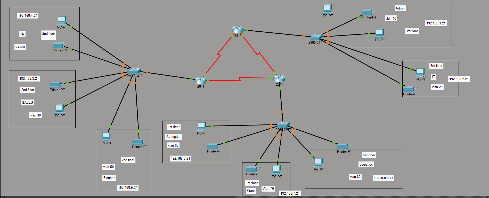

# Hotel Network Infrastructure Project

## Project Overview

This project demonstrates the design and configuration of a complete hotel network infrastructure using Cisco networking technologies in Cisco Packet Tracer. The network separates guest, staff, administrative, and management traffic across floors using VLANs, Router-on-a-Stick inter-VLAN routing, DHCP services, and dynamic OSPF routing between floor routers.

## Network Topology



## Technologies & Protocols Used

* **Cisco IOS (Routers & Switches)**
* **VLAN Segmentation**
* **802.1Q Trunking**
* **Router-on-a-Stick Inter-VLAN Routing**
* **OSPF Dynamic Routing**
* **DHCP Service Configuration**
* **Spanning Tree Protocol (STP)**
* **Network Security & Remote Access (SSH)**
* **Connectivity Verification & Troubleshooting**

## Project Structure

```text
Hotel-Network/
├── Cisco Packet Tracer/
│   ├── Hotel-Network.pkt
│   └── ---Project Hotel network.pkt
├── Documentation/
│   ├── Project-Overview.md
│   ├── IP-Addressing.md
│   ├── VLAN-Configuration.md
│   ├── OSPF-Routing.md
│   ├── Router-Configuration.md
│   ├── Switch-Configuration.md
│   ├── Verification.md
│   └── Final-Notes.md
├── ROUTER CONFIGURATIONS/
│   ├── R1-1st-floor-config.txt
│   ├── R2-2nd-floor-config.txt
│   └── R3-3rd-floor-config.txt
└── Topology/
    └── topology.png
```

## Device Configurations

Floor router running configurations are available in [`ROUTER CONFIGURATIONS`](ROUTER%20CONFIGURATIONS/):
- **1st Floor Router (R1):** `R1-1st-floor-config.txt`
- **2nd Floor Router (R2):** `R2-2nd-floor-config.txt`
- **3rd Floor Router (R3):** `R3-3rd-floor-config.txt`

## Documentation

Detailed step-by-step design documentation is available in [`Documentation`](Documentation/):
- [Project Overview](Documentation/Project-Overview.md)
- [IP Addressing Plan](Documentation/IP-Addressing.md)
- [VLAN Configuration](Documentation/VLAN-Configuration.md)
- [OSPF Routing Configuration](Documentation/OSPF-Routing.md)
- [Router Configuration Details](Documentation/Router-Configuration.md)
- [Switch Configuration Details](Documentation/Switch-Configuration.md)
- [Verification & Testing](Documentation/Verification.md)
- [Final Notes](Documentation/Final-Notes.md)

## How to Run in Cisco Packet Tracer

1. Download and open `Hotel-Network.pkt` in Cisco Packet Tracer.
2. Wait for link convergence (green status LEDs).
3. Test connectivity across floors and departments using `ping` and verify routing with `show ip route`.
